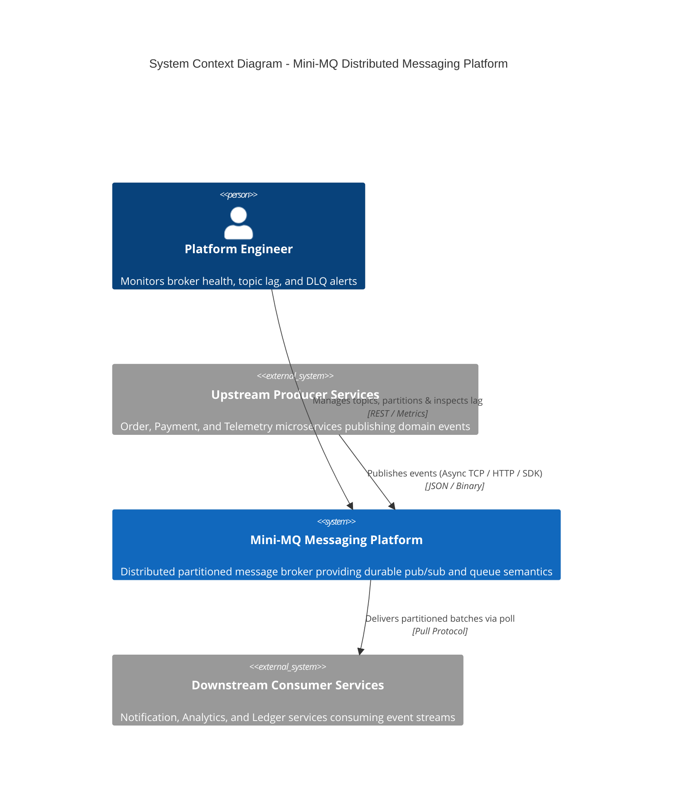
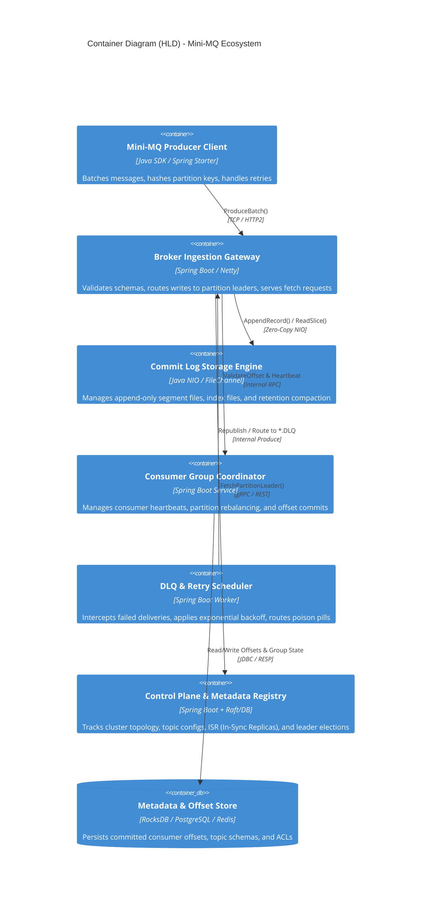
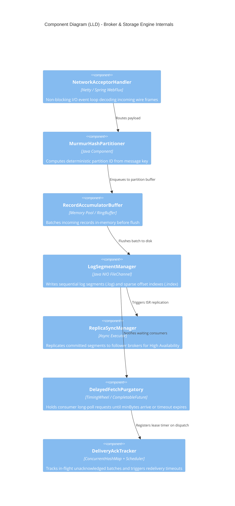
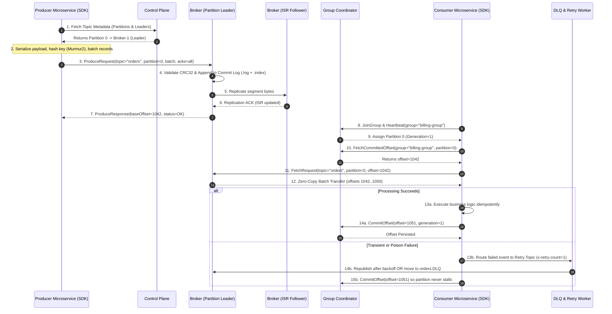

# Mini-MQ: Distributed Event Streaming & Message Broker

[](https://openjdk.org/)
[](https://spring.io/projects/spring-boot)
[]()
[]()

**Mini-MQ** is a lightweight, high-throughput, partitioned distributed messaging broker and event-streaming platform built with Java and Spring Boot. Inspired by Apache Kafka and RabbitMQ, it decouples event producers from downstream consumers using persistent append-only commit logs, consumer group offset tracking, dead-letter routing, and partitioned horizontal scaling.

---

## Table of Contents
1. [Architectural Paradigm: Why Distributed Messaging over REST / OpenFeign / WebClient?](#1-architectural-paradigm-why-distributed-messaging-over-rest--openfeign--webclient)
2. [How Distributed Messaging Works in Real Life vs. Mini-MQ](#2-how-distributed-messaging-works-in-real-life-vs-mini-mq)
3. [C4 Model Architecture (The Four C's of Abstraction)](#3-c4-model-architecture-the-four-cs-of-abstraction)
   - [Level 1: System Context Diagram](#level-1-system-context-diagram)
   - [Level 2: Container Diagram (HLD)](#level-2-container-diagram-hld)
   - [Level 3: Component Diagram (LLD)](#level-3-component-diagram-lld)
   - [Level 4: Code-Level Class & Package Structure](#level-4-code-level-class--package-structure)
4. [Deep-Dive Microservice Component Specifications (The 6 Core Parameters)](#4-deep-dive-microservice-component-specifications-the-6-core-parameters)
   - [4.1 Broker Ingestion & Routing Gateway (`mini-mq-broker`)](#41-broker-ingestion--routing-gateway-mini-mq-broker)
   - [4.2 Partitioned Storage & Commit Log Engine (`mini-mq-storage`)](#42-partitioned-storage--commit-log-engine-mini-mq-storage)
   - [4.3 Consumer Group & Offset Coordinator (`mini-mq-coordinator`)](#43-consumer-group--offset-coordinator-mini-mq-coordinator)
   - [4.4 Dead Letter Queue (DLQ) & Retry Processor (`mini-mq-dlq-worker`)](#44-dead-letter-queue-dlq--retry-processor-mini-mq-dlq-worker)
   - [4.5 Metadata Registry & Cluster Control Plane (`mini-mq-control-plane`)](#45-metadata-registry--cluster-control-plane-mini-mq-control-plane)
5. [End-to-End Workflow & Message Lifecycle](#5-end-to-end-workflow--message-lifecycle)
6. [Design Patterns Implemented](#6-design-patterns-implemented)
   - [Java & Object-Oriented Design Patterns](#java--object-oriented-design-patterns)
   - [Microservices & Distributed System Patterns](#microservices--distributed-system-patterns)
7. [Quick Start & Local Deployment](#7-quick-start--local-deployment)

---

## 1. Architectural Paradigm: Why Distributed Messaging over REST / OpenFeign / WebClient?

In microservice architectures, inter-service communication generally falls into **Synchronous Point-to-Point** (REST, OpenFeign, gRPC) or **Non-Blocking Reactive** (Spring WebClient) versus **Asynchronous Event-Driven Messaging** (Mini-MQ).

| Architectural Dimension | Synchronous REST / OpenFeign | Reactive WebClient (Non-Blocking HTTP) | Distributed Messaging (`Mini-MQ`) |
| :--- | :--- | :--- | :--- |
| **Temporal Coupling** | **Tight:** Producer and Consumer must both be online simultaneously. | **Tight:** Frees caller threads, but target service must still be up to accept the socket. | **Decoupled:** Producers write to the broker even if consumers are offline for hours. |
| **Traffic Spikes & Backpressure** | Consumer is overwhelmed by sudden bursts (cascading `503` failures). | Prevents thread exhaustion on caller, but still floods downstream DB/CPU. | **Natural Buffering:** Broker absorbs spikes on disk; consumers pull at their own pace. |
| **Fan-Out / Broadcast** | Producer must know every downstream URL and call them sequentially/parallelly. | Producer manages multiple `Mono`/`Flux` streams; adding a subscriber requires code changes. | **Pub/Sub Fan-Out:** Multiple independent consumer groups read the same topic stream zero-copy. |
| **Message Durability & Replay** | Lost on network timeout unless manually persisted in a local DB. | In-flight reactive streams are volatile; crashes drop uncompleted emissions. | **Persistent Commit Log:** Messages survive broker/consumer restarts and can be replayed by offset. |
| **Failure Recovery** | Requires complex client-side retry loops, circuit breakers, and fallback state. | Retries stay in memory; prolonged outages cause OOM or dropped signals. | **At-Least-Once + DLQ:** Unacknowledged messages are automatically redelivered or routed to DLQ. |

### When Mini-MQ Beats OpenFeign & WebClient
* **Eliminating Cascading Failures:** With OpenFeign, if an `InventoryService` slows down from $20\text{ ms}$ to $5\text{ s}$, `OrderService` threads block and exhaust the Tomcat thread pool. Even with `WebClient`, while caller threads aren't blocked, the downstream service is still hammered with live HTTP requests. Mini-MQ acts as a **shock absorber**, flattening traffic spikes into steady sequential disk reads.
* **Event Replay & Auditability:** HTTP requests are ephemeral—once processed, they vanish. Mini-MQ retains ordered event logs, allowing new microservices (e.g., an Analytics or Audit service) to spin up weeks later and replay historical events from $\text{offset} = 0$.

---

## 2. How Distributed Messaging Works in Real Life vs. Mini-MQ

### Real-World Analogy: The Registered Postal Sorting Hub
Think of synchronous REST/OpenFeign as a **phone call**: both parties must pick up at the exact same moment, and if one line is busy, the communication fails. 

Distributed messaging works like a **centralized postal sorting hub with numbered PO Boxes**:
1. **Producers (Senders)** drop stamped envelopes (events) at the intake counter with a destination category (`Topic`) and routing key (`Partition Key`). Once the clerk stamps a receipt (`ACK`), the sender walks away immediately.
2. **Partitions (Sorting Lanes)** divide mail by routing key hash (e.g., $\text{orderId} \bmod N$), guaranteeing that all letters for the same customer stay in strict chronological order while different lanes operate in parallel.
3. **Consumer Groups (Recipient Teams)** hold keys to specific PO boxes. Each team maintains a bookmark (`Offset`) tracking the last letter processed. If a team goes on strike (service crash), letters pile up safely in the box until they return.

### How Mini-MQ Implements This Under the Hood
* **Topics & Partitions:** Logical streams (`Topics`) are split into physical shards (`Partitions`) distributed across broker nodes.
* **Append-Only Commit Log:** Instead of expensive random-access B-Tree updates (`UPDATE/DELETE`), Mini-MQ appends serialized byte frames sequentially to segment files on disk ($\mathcal{O}(1)$ write complexity).
* **Pull-Based Consumption:** Consumers actively poll Mini-MQ (`fetch(topic, partition, offset, maxBytes)`), preventing fast producers from overwhelming slow consumers.
* **Acknowledgment & Offset Commit:** Consumers process a batch and commit their latest offset (`commitOffset()`), guaranteeing **At-Least-Once** delivery semantics.

---

## 3. C4 Model Architecture (The Four C's of Abstraction)

### Level 1: System Context Diagram
Illustrates how `Mini-MQ` sits between upstream event producers, downstream consuming microservices, and platform operators.



### Level 2: Container Diagram (HLD)
High-Level Design showing the deployable microservices, data stores, and network boundaries inside the `Mini-MQ` ecosystem.



### Level 3: Component Diagram (LLD)
Low-Level Design zooming inside the **Broker Ingestion & Storage Core** to expose internal Spring beans, thread pools, and memory buffers.



### Level 4: Code-Level Class & Package Structure
```text
mini-mq/
├── mini-mq-common/                 # Shared wire protocols, serializers, CRC32 checksums
│   ├── model/                      # MessageEnvelope, PartitionMetadata, OffsetCommitRequest
│   └── codec/                      # BinaryFrameEncoder, JsonMessageSerializer
├── mini-mq-control-plane/          # Cluster topology, topic creation, leader election
│   ├── registry/                   # BrokerRegistry, TopicMetadataService
│   └── election/                   # LeaderElectionManager
├── mini-mq-broker/                 # Core ingestion, routing, and long-poll fetch server
│   ├── network/                    # NettyBrokerServer, RequestDispatcher
│   ├── partition/                  # PartitionRouter, Murmur2Partitioner
│   ├── log/                        # CommitLog, LogSegment, SparseOffsetIndex
│   └── purgatory/                  # DelayedFetchOperation, HierarchicalTimingWheel
├── mini-mq-coordinator/            # Consumer group membership & offset tracking
│   ├── group/                      # ConsumerGroupManager, RebalanceStrategy (Range/Sticky)
│   └── offset/                     # OffsetManager, OffsetStorageRepository
├── mini-mq-dlq-worker/             # Retry backoff & Dead-Letter Queue isolation
│   └── retry/                      # ExponentialBackoffScheduler, PoisonPillHandler
└── mini-mq-client-sdk/             # Embeddable Java/Spring Boot Producer & Consumer SDK
    ├── producer/                   # MiniMqProducer, RecordBatcher, RetryInterceptor
    └── consumer/                   # MiniMqConsumer, HeartbeatThread, AutoCommitManager
```

---

## 4. Deep-Dive Microservice Component Specifications (The 6 Core Parameters)

### 4.1 Broker Ingestion & Routing Gateway (`mini-mq-broker`)

1. **Primary Purpose & Key Responsibilities**
   - Serves as the front-door data plane for all producers and consumers.
   - Validates incoming message envelopes (payload size limits, schema headers, CRC32 integrity checksums).
   - Routes records to the authoritative partition leader and manages long-polling (`DelayedFetchPurgatory`) so consumers receive messages immediately upon arrival without CPU-wasting busy loops.
2. **Measuring Success (KPIs)**
   - **Ingestion Throughput:** Sustained writes/sec ($\ge 50,000\text{ msgs/sec}$ per node).
   - **Produce Latency ($p_{99}$):** $< 5\text{ ms}$ for `acks=1`, $< 15\text{ ms}$ for `acks=all`.
   - **Error Rate:** $< 0.01\%$ rejected/corrupted frames; $0$ silent message drops.
3. **Data Flow, Response Times & Failure Impact**
   - **Flow:** `Producer -> NetworkAcceptor -> Partitioner -> RecordAccumulator -> CommitLog -> ACK`.
   - **Response Times:** $1\text{--}3\text{ ms}$ in-memory/page-cache append; $5\text{--}12\text{ ms}$ with synchronous `fsync` + follower replication.
   - **Failure Impact:** If a single broker node crashes, clients receive a `NotLeaderForPartitionException`, refresh metadata from the Control Plane within $200\text{ ms}$, and fail over to the newly promoted replica leader with zero data loss (for `acks=all`).
4. **Technologies, Advantages & Limitations**
   - **Technologies:** Java 17+, Spring Boot 3, Netty (non-blocking NIO), Jackson / Protobuf, Micrometer + Prometheus.
   - **Advantages:** Event-loop architecture handles thousands of concurrent persistent connections with minimal thread context switching.
   - **Limitations:** Stateful partition ownership requires sticky routing; rolling restarts require controlled partition leadership handoff to avoid brief latency spikes.
5. **Scalability & Performance Targets**
   - **Horizontal Scaling:** Add broker nodes and reassign topic partitions across nodes linearly.
   - **Targets:** $10,000+$ concurrent TCP connections per broker; network saturation up to $1\text{ Gbps}$ via zero-copy `FileChannel.transferTo()`.
6. **Security, Reliability & Compliance**
   - **Security:** TLS 1.3 encryption in transit; SASL/JWT token authentication on connection handshake; Topic-level ACLs (`READ`, `WRITE`, `CREATE`).
   - **Reliability:** Idempotent producer sequence numbers (`ProducerID + SequenceNumber`) prevent duplicate writes during network retries.
   - **Compliance:** Immutable audit trail of publish timestamps and producer identities for SOC2/GDPR event lineage.

---

### 4.2 Partitioned Storage & Commit Log Engine (`mini-mq-storage`)

1. **Primary Purpose & Key Responsibilities**
   - Persists events durably in strictly ordered, immutable, append-only log segments per partition.
   - Maintains sparse offset index files (`.index`) and timestamp index files (`.timeindex`) for $\mathcal{O}(\log N)$ binary-search lookups.
   - Executes background log retention policies (time-based TTL, size-based eviction, and key-based log compaction).
2. **Measuring Success (KPIs)**
   - **Disk Write Amplification Factor:** $\approx 1.0\times$ (pure sequential I/O).
   - **Seek-to-Read Latency ($p_{95}$):** $< 2\text{ ms}$ for cold offset lookup via sparse index.
   - **Storage Efficiency:** $> 65\%$ payload compression ratio using LZ4/Snappy batch compression.
3. **Data Flow, Response Times & Failure Impact**
   - **Flow:** `Batch Bytes -> OS Page Cache -> Segment File (.log) -> Sparse Index (.index) -> Background Flush`.
   - **Response Times:** $< 0.5\text{ ms}$ OS page-cache write; $2\text{--}8\text{ ms}$ disk `fsync`.
   - **Failure Impact:** Disk saturation or I/O stall halts writes on affected partitions. Mitigated via disk watermark alerts ($85\%$ warning, $95\%$ read-only protection) and multi-broker replication.
4. **Technologies, Advantages & Limitations**
   - **Technologies:** Java NIO (`FileChannel`, `MappedByteBuffer`), CRC32C hardware-accelerated checksums, LZ4/Snappy compression.
   - **Advantages:** Sequential disk I/O rivals RAM speed; leverages OS kernel page cache and `sendfile()` zero-copy transfers (bypassing JVM heap garbage collection).
   - **Limitations:** Does not support arbitrary SQL-style querying or mid-log record mutation—records can only be appended at the tail and truncated from the head.
5. **Scalability & Performance Targets**
   - **Scalability:** Partition-level isolation allows independent segment rolling ($1\text{ GB}$ per segment) and parallel disk I/O across mounted NVMe volumes.
   - **Targets:** $500+\text{ MB/s}$ sequential write throughput; $< 100\text{ ms}$ recovery scan on broker restart using index checkpoints.
6. **Security, Reliability & Compliance**
   - **Security:** OS-level volume encryption (LUKS/EBS AES-256) for data at rest; optional payload-level field encryption.
   - **Reliability:** Every record stores a CRC32 checksum; corrupted trailing records after a power loss are detected and truncated automatically on boot.
   - **Compliance:** Configurable retention windows (e.g., 7 days, 30 days, or infinite compacted state) enforce GDPR "right to erasure" via tombstones (`value = null`).

---

### 4.3 Consumer Group & Offset Coordinator (`mini-mq-coordinator`)

1. **Primary Purpose & Key Responsibilities**
   - Coordinates multiple consumer instances sharing a `group.id` so each partition is consumed by **at most one** consumer instance within that group.
   - Tracks consumer liveness via periodic heartbeats and triggers **Partition Rebalancing** (Range or Sticky Cooperative Assignor) when consumers join, leave, or crash.
   - Stores and serves committed consumer offsets (`__consumer_offsets`).
2. **Measuring Success (KPIs)**
   - **Rebalance Convergence Time:** $< 1,500\text{ ms}$ from consumer crash detection to partition reassignment.
   - **Offset Commit Latency ($p_{99}$):** $< 5\text{ ms}$.
   - **Consumer Lag Accuracy:** Real-time lag calculation ($\text{LogEndOffset} - \text{CommittedOffset}$) updated every $1\text{ s}$.
3. **Data Flow, Response Times & Failure Impact**
   - **Flow:** `Consumer Heartbeat -> Session Timer Check -> Rebalance State Machine -> OffsetCommit(group, topic, partition, offset)`.
   - **Response Times:** $< 2\text{ ms}$ heartbeat response; $< 5\text{ ms}$ offset commit.
   - **Failure Impact:** If the Coordinator temporarily fails, active consumers continue reading from their local in-memory offset until the next rebalance or commit cycle, where SDK retry logic automatically reconnects to the newly elected Coordinator.
4. **Technologies, Advantages & Limitations**
   - **Technologies:** Spring Boot, Concurrent State Machine (`PreparingRebalance`, `CompletingRebalance`, `Stable`), RocksDB / PostgreSQL / Redis for offset persistence.
   - **Advantages:** Enables effortless horizontal scaling of consumers—spinning up new consumer pods automatically redistributes partition workload.
   - **Limitations:** Maximum consumer parallelism per group is capped at the topic's partition count ($\text{Max Active Consumers} = N\text{ Partitions}$; extra consumers sit as hot standbys).
5. **Scalability & Performance Targets**
   - **Scalability:** Coordinator partitions consumer groups by $\text{hash}(\text{group.id}) \bmod \text{coordinatorNodes}$, distributing heartbeat load horizontally.
   - **Targets:** Supports $5,000+$ active consumer groups and $50,000+$ heartbeats/sec.
6. **Security, Reliability & Compliance**
   - **Security:** Group-level authorization prevents unauthorized services from hijacking a `group.id` or resetting production offsets.
   - **Reliability:** Generation IDs (`generationId`) fence off "zombie" consumers that suffered a long GC pause, rejecting stale offset commits after a rebalance.
   - **Compliance:** Offset commit history provides verifiable proof of message consumption for financial and regulatory SLAs.

---

### 4.4 Dead Letter Queue (DLQ) & Retry Processor (`mini-mq-dlq-worker`)

1. **Primary Purpose & Key Responsibilities**
   - Prevents "poison pill" messages (malformed JSON, permanent business rule violations, downstream outages) from blocking partition progress indefinitely.
   - Manages non-blocking delayed retry topics (`topic.retry.10s`, `topic.retry.1m`, `topic.retry.5m`) with exponential backoff and jitter.
   - Routes exhausted messages to a dedicated Dead Letter Queue (`topic.dlq`) enriched with failure stack traces, original partition/offset metadata, and retry counts.
2. **Measuring Success (KPIs)**
   - **Head-of-Line Blocking Incidents:** $0$ partition stalls caused by unprocessable messages.
   - **Retry Scheduling Precision:** Within $\pm 50\text{ ms}$ of target backoff delay.
   - **DLQ Replay Success Rate:** $100\%$ lossless redrive back to primary topic once bug is patched.
3. **Data Flow, Response Times & Failure Impact**
   - **Flow:** `Consumer NACK / Timeout -> Retry Topic (with deliverAfter header) -> Scheduler Poll -> Main Topic OR *.DLQ`.
   - **Response Times:** $< 10\text{ ms}$ to park a failed message into retry/DLQ so the main consumer moves immediately to $\text{offset} + 1$.
   - **Failure Impact:** If the DLQ worker stops, messages accumulate safely in the retry topics without affecting live ingestion or healthy consumer traffic.
4. **Technologies, Advantages & Limitations**
   - **Technologies:** Spring Boot Scheduled/Reactive Workers, Header-based routing (`x-retry-count`, `x-exception-reason`, `x-original-topic`).
   - **Advantages:** Keeps the primary consumption pipeline fast and non-blocking while preserving full diagnostic context for failed events.
   - **Limitations:** Delayed retries introduce out-of-order processing for the specific failed key relative to newer events.
5. **Scalability & Performance Targets**
   - **Scalability:** Stateless worker pool scaling dynamically based on retry-topic consumer lag.
   - **Targets:** Processes $10,000+$ retry/DLQ transitions per second with $< 20\text{ ms}$ overhead.
6. **Security, Reliability & Compliance**
   - **Security:** Sensitive PII in DLQ error headers is masked/redacted before logging; DLQ inspection endpoints require elevated admin roles.
   - **Reliability:** Idempotent replay tokens prevent duplicate side effects when an operator triggers a bulk DLQ redrive.
   - **Compliance:** Retains full audit trail of failure causes and manual operator redrive actions.

---

### 4.5 Metadata Registry & Cluster Control Plane (`mini-mq-control-plane`)

1. **Primary Purpose & Key Responsibilities**
   - Acts as the single source of truth for cluster state: active broker nodes, topic definitions, partition counts, replication factors, and In-Sync Replica (ISR) lists.
   - Detects dead brokers via heartbeat misses and executes deterministic **Leader Election** for orphaned partitions.
   - Exposes administrative REST APIs for creating/altering topics and querying cluster health.
2. **Measuring Success (KPIs)**
   - **Failover Detection & Election Time:** $< 1,000\text{ ms}$ total failover window.
   - **Metadata Propagation Latency:** $< 100\text{ ms}$ across all broker nodes and client caches.
   - **Control Plane Availability:** $99.99\%$ uptime.
3. **Data Flow, Response Times & Failure Impact**
   - **Flow:** `Admin/Client Metadata Request -> In-Memory Cluster State Cache -> JSON/gRPC Topology Response`.
   - **Response Times:** $< 3\text{ ms}$ metadata lookup; $200\text{--}800\text{ ms}$ full partition leader election.
   - **Failure Impact:** If the Control Plane is temporarily unreachable, existing producers and consumers continue operating seamlessly using cached metadata; only new topic creation and broker failovers pause until recovery.
4. **Technologies, Advantages & Limitations**
   - **Technologies:** Spring Boot, Spring Actuator, Concurrent Metadata Cache, Consensus / Distributed Lock backend.
   - **Advantages:** Decouples cluster coordination from hot-path byte streaming, keeping broker I/O threads completely focused on throughput.
   - **Limitations:** Metadata changes are eventually consistent across client SDK caches (clients refresh periodically or immediately upon receiving a stale-leader error).
5. **Scalability & Performance Targets**
   - **Scalability:** Active-standby controller quorum handles cluster state; read-heavy metadata queries are served directly from broker-side caches.
   - **Targets:** Supports $100+$ broker nodes, $10,000+$ topics, and $100,000+$ partitions.
6. **Security, Reliability & Compliance**
   - **Security:** mTLS between control plane and brokers; RBAC-protected administrative endpoints.
   - **Reliability:** Unclean leader election is disabled by default (`unclean.leader.election.enable=false`) to prevent data loss from out-of-sync replicas.
   - **Compliance:** Logs all administrative mutations (topic deletions, ACL modifications, partition expansions) to an immutable audit log.

---

## 5. End-to-End Workflow & Message Lifecycle



### Step-by-Step Walkthrough
1. **Metadata Discovery:** On startup, the Producer SDK queries the Control Plane to map topic partitions to their current leader broker addresses.
2. **Key-Based Partitioning & Batching:** The Producer hashes the message key ($\text{partition} = |\text{murmur2}(\text{key})| \bmod \text{numPartitions}$) to guarantee ordering per entity (e.g., `orderId`), and accumulates records into memory batches to amortize network overhead.
3. **Durable Ingestion & Replication:** The Partition Leader validates the batch checksum, appends it sequentially to its active `.log` segment, updates the `.index` file, and replicates the bytes to In-Sync Replicas (ISRs) before returning an acknowledgment (`ACK`).
4. **Consumer Group Assignment:** Consumers join a `group.id` via the Coordinator, which assigns exclusive partitions to each active member and monitors liveness via background heartbeats.
5. **Long-Poll Fetch & Zero-Copy Delivery:** Consumers pull batches starting from their last committed offset. If no new messages exist, the Broker parks the request in `DelayedFetchPurgatory` until messages arrive or the timeout expires.
6. **Idempotent Processing, Commit, or DLQ Isolation:** Upon successful processing, the consumer commits $\text{offset} + 1$. If an event repeatedly fails, it is diverted to a retry/DLQ topic and its offset is committed on the main partition—preventing head-of-line blocking.

---

## 6. Design Patterns Implemented

### Java & Object-Oriented Design Patterns

| Pattern | Where Used in `Mini-MQ` | Concrete Problem Solved |
| :--- | :--- | :--- |
| **Strategy Pattern** | `Partitioner` (`MurmurHashPartitioner`, `RoundRobinPartitioner`) & `RebalanceStrategy` (`RangeAssignor`, `StickyAssignor`) | Swaps key-routing and consumer partition-assignment algorithms at runtime via configuration without modifying broker or coordinator core loops. |
| **Builder Pattern** | `MessageEnvelope.Builder`, `ProducerConfig.Builder`, `ConsumerConfig.Builder` | Safely constructs immutable configuration and message objects with dozens of optional headers, timeouts, and ack levels. |
| **Observer / Pub-Sub Pattern** | `DelayedFetchPurgatory` & `LogAppendListener` | Notifies parked long-polling consumer futures the instant new bytes are appended to a partition's commit log. |
| **Chain of Responsibility** | Broker Request Pipeline (`AuthInterceptor -> QuotaThrottler -> SchemaValidator -> PartitionRouter`) | Processes incoming network frames through modular, composable validation and security stages before hitting storage. |
| **Singleton & Flyweight** | `BrokerMetadataCache` & `CodecRegistry` | Shares thread-safe cluster topology state and stateless serializer instances across thousands of concurrent Netty worker channels. |
| **Factory Method** | `LogSegmentFactory` & `TransportChannelFactory` | Encapsulates creation of `.log`/`.index` file pairs and TCP/HTTP transport channels based on environment profiles. |
| **Template Method** | `AbstractBackgroundWorker` (Retention cleaner, Heartbeat monitor, DLQ scheduler) | Standardizes lifecycle management (`start()`, `pollCycle()`, `gracefulShutdown()`, exception metrics) across all daemon threads. |

### Microservices & Distributed System Patterns

| Pattern | Implementation in `Mini-MQ` | Architectural Benefit |
| :--- | :--- | :--- |
| **Partitioned Commit Log (Sharding)** | Topics split into $N$ independent ordered partitions across brokers | Breaks single-node I/O bottlenecks; enables horizontal read/write scaling while preserving per-key ordering. |
| **Competing Consumers** | Consumer Groups (`group.id`) coordinated by `mini-mq-coordinator` | Parallelizes event processing across multiple microservice replicas while guaranteeing each message is processed by only one worker per group. |
| **Dead Letter Queue (DLQ) & Exponential Backoff** | `mini-mq-dlq-worker` with tiered retry topics (`*.retry`, `*.dlq`) | Isolates corrupt/poison messages so a single bad payload never blocks an entire partition stream. |
| **Transactional Outbox / Idempotent Producer** | `ProducerId + SequenceNumber` deduplication on broker ingestion | Guarantees **Exactly-Once** log appends even when producers retry timed-out network requests. |
| **Heartbeat & Lease / Fencing Token** | Consumer session heartbeats + monotonic `GenerationId` | Detects crashed consumers quickly and blocks stale "zombie" consumers from overwriting committed offsets after a rebalance. |
| **Control Plane / Data Plane Separation** | `mini-mq-control-plane` (metadata/elections) isolated from `mini-mq-broker` (byte streaming) | Prevents administrative queries and leader election logic from interfering with high-throughput message I/O. |

---

## 7. Quick Start & Local Deployment

### Prerequisites
- **Java 17+** (JDK 17 or 21 recommended)
- **Maven 3.8+**
- **Docker & Docker Compose** (optional, for multi-broker cluster mode)

### Build & Run Locally
```bash
# 1. Clone the repository
git clone https://github.com/coder-stat920715/mini-mq.git
cd mini-mq

# 2. Build all modules and run unit/integration tests
mvn clean install

# 3. Start Control Plane & Broker Node
java -jar mini-mq-control-plane/target/mini-mq-control-plane-1.0.0.jar &
java -jar mini-mq-broker/target/mini-mq-broker-1.0.0.jar
```

### Sample Java Producer & Consumer Usage
```java
// Publishing an ordered event
MiniMqProducer<String, OrderEvent> producer = MiniMqProducer.<String, OrderEvent>builder()
    .bootstrapServers("localhost:9092")
    .acks("all")
    .enableIdempotence(true)
    .build();

producer.send(new ProducerRecord<>("orders-topic", order.getOrderId(), orderEvent));

// Consuming with a Consumer Group
MiniMqConsumer<String, OrderEvent> consumer = MiniMqConsumer.<String, OrderEvent>builder()
    .bootstrapServers("localhost:9092")
    .groupId("payment-processor-group")
    .autoOffsetReset("earliest")
    .build();

consumer.subscribe(List.of("orders-topic"));
while (true) {
    ConsumerRecords<String, OrderEvent> records = consumer.poll(Duration.ofMillis(500));
    for (ConsumerRecord<String, OrderEvent> record : records) {
        processPayment(record.value());
    }
    consumer.commitSync();
}
```